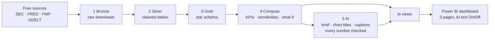

# Executive Market-Risk Dashboard: data pipeline and AI layer

BSc thesis, Business Informatics, German International University (GIU): *Interactive Data Visualization for Executive
Decision-Making: An AI-Driven Approach to Financial Market Insights*. Fares · Supervisor: Dr. Minar El-Aasser.

**In one sentence:** every morning this code downloads free market and company data, cleans it, calculates every number
the dashboard shows, lets an AI explain those numbers (each figure checked against the calculation), and stores the
result in a database that the Power BI dashboard reads.

> **The system computes, the AI explains.** All numbers come from Python code; the AI only writes text about them,
> and a checker rejects any figure that was not computed.

## How it works

Runs automatically every day on GitHub Actions (06:17 Cairo, backup run 08:47), which also keeps the free database awake.

## Where everything is

| Folder / file | What it is |
|---|---|
| `config/settings.yaml` | **The only place companies, peers, risk variables and thresholds are named** (company-agnostic). |
| `src/dashboard/` | The pipeline code, one file per step (table below). |
| `tests/` | Automatic tests (104). They never touch the real database. |
| `docs/METHOD_NOTES.md` | Every method decision, with the sentence to use in the thesis and its sources. |
| `docs/GITHUB_SETUP.md` | How the daily GitHub run and its secrets are set up. |
| `scripts/` | Windows double-click launchers: run everything, the news audit, save API keys. |
| `.github/workflows/daily.yml` | The daily automatic run. |
| `.env` (laptop only, never uploaded) | Passwords and API keys. |
| `data/`, `logs/` (laptop only) | Raw downloads and the output of the last local run. |

## What each step does

| Step | File | In | Out (database) |
|---|---|---|---|
| 0 Settings | `config.py` | `settings.yaml` | checked settings (stops early if a setting is wrong) |
| 1 Bronze | `bronze.py` | SEC filings, 15 FRED series, FMP share prices, GDELT news | raw files, untouched |
| 2 Silver | `silver.py` | raw files | `silver.*`: clean, typed, de-duplicated; every dropped value counted with its reason |
| 3 Gold | `gold.py` | silver | `gold.*`: star schema, grain stated for every table |
| 4 Compute | `compute.py`, `valuation.py`, `robustness.py`, `attention.py` | gold | KPIs, peer gaps, sensitivities, what-if, past-episode replays, valuation, rule-based alerts |
| 5 AI | `insights.py`, `ai.py` | computed results only | `ai.*`: brief (situation, complication, resolution), page notes, chart titles and captions, options to consider |
| Views | `bi.py` | gold + compute + ai | `bi.*`: ready-made views that Power BI reads |
| Helpers | `db.py`, `tags.py`, `news_audit.py`, `setkey.py` | | database connection, find a company's SEC tags, news-filter audit, save a key |

## The database (Supabase, hosted PostgreSQL)

| Schema | Holds |
|---|---|
| `silver` | Cleaned source data: `sec_fact`, `fred_observation`, `stock_price`, `share_count`, `news_article`, `filing`, plus the audit tables `drop_summary`, `missing_quarter`, `load_log`. |
| `gold` | Star schema. Dimensions: `dim_company`, `dim_date`, `dim_variable`. Facts: `fact_financials` (company × metric × quarter), `fact_market` (variable × day), `fact_stock`, `fact_shares`, `fact_filing`, `fact_news`; plus the computed tables. |
| `ai` | Every AI brief and every attempt, with the prompt version, the check result and the model used. |
| `bi` | The views Power BI reads: `companies`, `kpi_latest`, `kpi_trend`, `market_today`, `market_history`, `whatif`, `scenarios`, `robustness`, `stock_history`, `valuation`, `attention`, `news`, `ai_brief`, `ai_recommendations`, `freshness`. |

## The AI layer in short

- **Round 1, rank:** the code computes candidate insights; the AI scores how relevant each is to an executive today.
  Final score = 0.5 significance + 0.3 relevance + 0.2 impact (adapted from LEVA, Zhao et al. 2025).
- **Round 2, brief:** a three-step story (situation, complication, resolution).
- **Round 3, story layer:** a note per page, an action title and a so-what caption per chart, options to consider,
  and the page to open first.
- **Checks:** every number must match a computed fact; a failed item is rewritten once, then replaced by fixed text.
  Cause and certainty words are flagged.
- **Study switch:** in Power BI, "AI text Off" hides all AI text; everything else stays identical.

## Running it by hand (Windows)

- Everything: double-click `scripts\run_all.bat`.
- One step: `python -m dashboard.<step>` (for example `python -m dashboard.ai`), with `src` on `PYTHONPATH`.
- Tests: `python -m pytest`.
