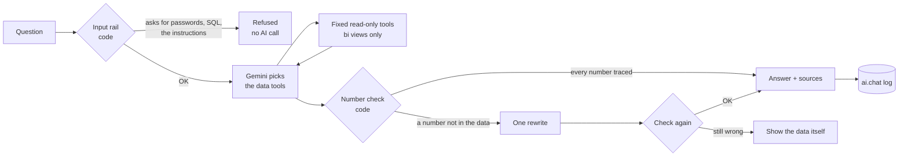

# Chatbot: "Ask about this page"

An AI chat that answers questions about the dashboard, from the dashboard's data, the latest
10-K/10-Q text and filtered news. Opened from a button on each Power BI page, already set to the
airline and the page the executive is looking at.

## How it answers (one question)



| Situation | What the user gets |
|---|---|
| Answer is in the data | Plain-language answer, numbers checked, sources listed (dashboard, 10-K/10-Q section, news article with link) |
| On topic but not in the data (e.g. "What is a 10-K?") | General knowledge, labelled **"not from your data"**, with no numbers |
| Off topic ("write a poem") | Polite refusal |
| Asks for passwords, keys, SQL or the instructions | Refused by code before the AI is called |

## Data tools (the only way the chatbot reaches data)

| Tool | Reads | Example question |
|---|---|---|
| `get_kpis` | `bi.kpi_latest` | "How does our margin compare with the others?" |
| `get_kpi_history` | `bi.kpi_trend` | "How has net debt moved over the last 3 years?" |
| `get_market_risks` | `bi.market_today` | "Which market risk matters most today?" |
| `run_what_if` | `bi.whatif` (same maths as the sliders) | "What if fuel rises 20% and rates 1 point?" |
| `get_valuation` | `bi.valuation` | "Who is cheapest on P/E?" |
| `search_news` | `bi.news` (GDELT + Finnhub, with summaries) | "Any news about our pilots?" |
| `search_filings` | `bi.filing_text` (full-text search of the latest 10-K and 10-Q) | "What does our 10-K say about fuel hedging?" |
| `get_ai_brief` | `bi.ai_brief` | "Summarise today's brief" |

Every argument is checked (company must be in the settings file, what-if moves within limits);
search words are passed as bound parameters, never pasted into SQL.

## Number rule

A number in an answer must be (a) a computed fact returned by a tool, or (b) written word for word
in an official text the tools returned (a 10-K/10-Q passage, or the already-checked AI brief).
**Numbers from news are not accepted**: news is untrusted text. Dates ("Oct 28"), report names
("10-Q", "Item 7A") and years are not counted as figures.

## Security

| Risk | Defence | Source |
|---|---|---|
| The AI writes harmful SQL | It never writes SQL: fixed, parameterised queries only | Pedro et al. (2025) |
| Too much database access | Own account `chat_reader`: read the `bi` views, add to `ai.chat`; nothing else (tested) | Pedro et al. (2025), permission hardening |
| Instructions hidden in news or filings | Tool results are marked untrusted; the prompt says never follow them | Greshake et al. (2023) |
| Asking for secrets or the instructions | Input rail refuses before any AI call; output rail blocks keys and connection strings | Rebedea et al. (2023) |
| Off-topic use | Topic rule in the prompt + refusal | Rebedea et al. (2023) |
| Invented numbers | Number check, one rewrite, then the data itself | Huang et al. (2025) |
| Over-trust in unsupported answers | General knowledge labelled, no numbers | Kim et al. (2024) |
| Using up the free AI quota | Optional password, 6 questions/minute, 40 per session | operational (no paper) |
| Admin account used by mistake | The chat page refuses to start with the `postgres` account | design |

## Setup (once, about 2 minutes)

1. Double-click `scripts\setup_chat.bat`. It creates the read-only account `chat_reader` with a random
   password (using your admin `DATABASE_URL` once), saves `CHAT_DATABASE_URL` in `.env`, checks the
   account can read only the dashboard views, and asks for your Finnhub key. Run it again any time to
   give the account a new password. (Manual alternative: run `sql/chat_reader_role.sql` in the Supabase
   SQL Editor and write the `CHAT_DATABASE_URL` line yourself.)
2. GitHub secret for the daily news download: repo -> Settings -> Secrets and variables -> Actions ->
   New repository secret `FINNHUB_API_KEY`.
3. Double-click `scripts\run_chat.bat` (opens http://localhost:8501; keep the window open).
4. In Power BI, Ctrl + click "Ask AI about this page" (plain click in reading view).

### The Power BI button (already added to every page)
1. **Modeling → New measure** (one per page; change the page number):
   ```DAX
   Chat Link P1 = "http://localhost:8501/?company=" & SELECTEDVALUE ( companies[ticker], "UAL" ) & "&page=1"
   ```
   (`companies` = the `bi companies` table in your model; use its name if Power BI renamed it.)
2. **Insert → Buttons → Blank**. Text: "Ask about this page".
3. **Format button → Action → On**, Type **Web URL**, click **fx** → Field value → `Chat Link P1`.
4. In Power BI Desktop: **Ctrl + click** the button. In reading view: normal click.

## Always on: hosted on Streamlit Community Cloud (free)

The chat page runs online, so nothing has to be started on the laptop. The Power BI button opens
`https://ual-exec-chat.streamlit.app/?company=UAL&page=N`.

Deploy once (about 5 minutes; done by the account owner, Claude cannot sign in for you):
1. Open share.streamlit.io and choose **Continue with GitHub**.
2. **Create app** > deploy from GitHub: repository `faressshady7/exec-dashboard`, branch `main`,
   main file path `src/dashboard/chat_app.py`, app URL `ual-exec-chat`.
3. **Advanced settings**: Python 3.12, and paste the secrets (values from your `.env`):
   ```toml
   GEMINI_API_KEY = "..."
   CHAT_DATABASE_URL = "..."      # the read-only chat_reader account, never DATABASE_URL
   CHAT_PASSWORD = "..."          # required online: the page refuses to open without it
   ```
4. **Deploy**. Streamlit installs `src/dashboard/requirements.txt` and starts the page.

Notes
- Online the page always asks for the password; on this computer (`scripts\run_chat.bat`, `CHAT_LOCAL=1`)
  it does not.
- After about 12 hours without visitors the app sleeps; the next visitor wakes it (roughly 30 seconds).
- New code on `main` is picked up automatically; the page reloads changed chat code by itself.
- The database account is still read-only and the admin account is refused (see Security).

## Evaluation data (`ai.chat`)

One row per question: question, answer, outcome (`answered`, `general`, `refused_security`,
`refused_topic`, `number_fallback`, `error`), tools used, sources, number-check result, whether a
rewrite was needed, wording flags, model, time taken. The chatbot can only add rows, never read
them, so one user's questions are never shown to another.

Useful counts for the thesis:
```sql
SELECT outcome, count(*), round(avg(latency_ms)) AS ms FROM ai.chat GROUP BY outcome;
SELECT avg((rewritten)::int) AS rewrite_rate, avg((check_passed)::int) AS checked FROM ai.chat
WHERE outcome IN ('answered', 'number_fallback');
```
Participants must agree in the consent form that their questions are logged.

## Limitations (state in the thesis)
- Answers depend on what the tools return: the chat knows the latest 10-K and 10-Q, not older reports.
- Full-text search matches words (with stemming), not meaning, so a question worded very differently
  from the report may find nothing; it then says so or answers from general knowledge (labelled).
- The number check proves a figure exists in the data, not that the sentence around it is right; the
  wording flags and a manual read of a sample of logged answers cover that.
- Questions differ between participants, so the chat is evaluated separately from the AI On/Off test.
